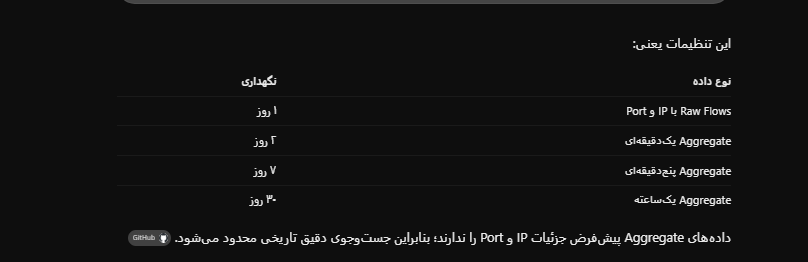
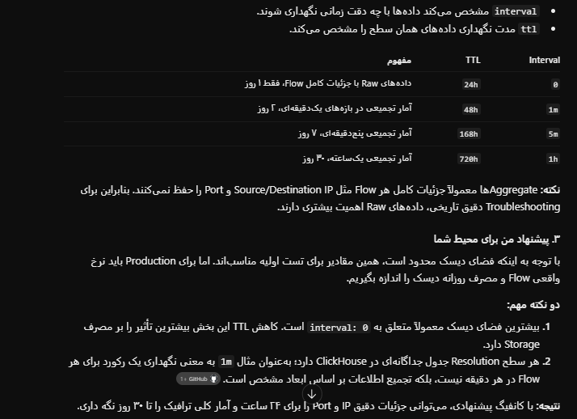
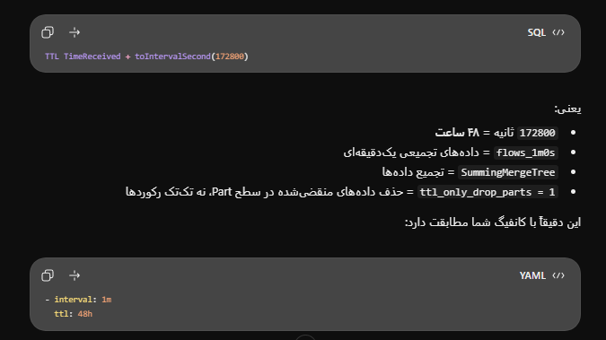
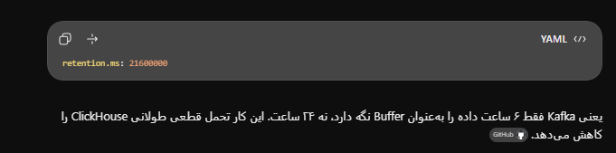
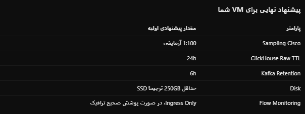
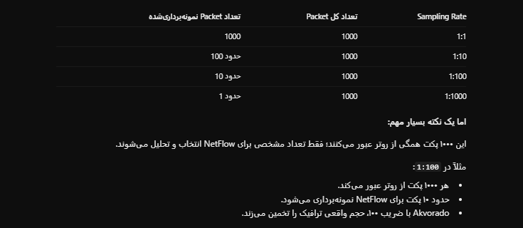
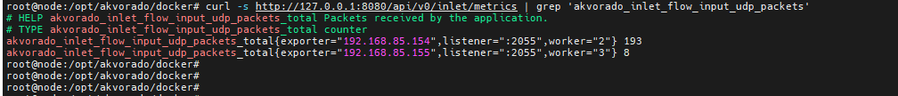

# install and config akvorado

port: 
8081/tcp webui
2055/udp netflow

161/udp snmp


## download
```sh

sudo mkdir -p /opt/akvorado
cd /opt/akvorado

sudo curl -fL \
  https://github.com/akvorado/akvorado/releases/latest/download/docker-compose-quickstart.tar.gz \
  -o akvorado.tar.gz

sudo tar -xzf akvorado.tar.gz


sudo docker compose config --quiet
sudo docker compose pull
sudo docker compose up -d --wait
sudo docker compose ps


http://SERVER-IP:8081


# check outlet service is working or not
# you see sampling rate from output of this api
curl -s http://127.0.0.1:8080/api/v0/outlet/flows\?limit\=3 | jq


nsenter -t $(pgrep -fo "akvorado outlet") -n tcpdump -c3 -pni eth0 port 161


# check data send from outlet to clickhouse or not
curl -s http://127.0.0.1:8080/api/v0/outlet/metrics | grep -P 'akvorado_outlet_clickhouse_(errors|flow)'


# clickhouse debug
docker compose exec clickhouse clickhouse-client
SHOW TABLES

SELECT name, element_count FROM system.dictionaries


```
## set password on ui

```sh
apt install -y apache2-utils
mkdir -p /opt/akvorado/auth


htpasswd -cB /opt/akvorado/auth/users.htpasswd admin

vim /opt/akvorado/docker/docker-compose-local.yml
----
services:
  traefik:
    volumes:
      - /opt/akvorado/auth/users.htpasswd:/etc/traefik/users.htpasswd:ro

  akvorado-console:
    labels:
      - "traefik.http.middlewares.console-password.basicauth.usersfile=/etc/traefik/users.htpasswd"
      - "traefik.http.routers.akvorado-console.middlewares=console-password,console-auth"
----


cd /opt/akvorado/docker

docker compose \
  -f docker-compose.yml \
  -f docker-compose-local.yml \
  up -d --force-recreate --no-deps \
  traefik akvorado-console


docker compose \
  -f docker-compose.yml \
  -f docker-compose-local.yml \
  exec traefik ls -l /etc/traefik/users.htpasswd

curl -I http://127.0.0.1:8081/

```


## check installation
```sh

# check netflow traffic recived or not
sudo tcpdump -ni any 'udp port 2055'


sudo docker compose logs --tail=100 akvorado-inlet
sudo docker compose logs --tail=100 akvorado-outlet


curl -s http://127.0.0.1:8080/api/v0/inlet/metrics | grep 'akvorado_inlet_flow_input_udp_packets_total'

curl -s http://127.0.0.1:8080/api/v0/outlet/metrics \
| grep -E 'akvorado_outlet_core_(received|forwarded)_flows_total|akvorado_outlet_flow.*errors'


```
## config snmp
```sh

# check snmp works on remote device

sudo apt install -y snmp

snmpget -v2c -c 'AKVORADO-SNMP' 192.168.85.154 1.3.6.1.2.1.1.5.0


cd /opt/akvorado
sudo nano config/outlet.yaml
----
metadata:
  providers:
    - type: snmp
      credentials:
        "192.168.232.244/32":
          communities:
            - "public"
----

# if we have multiple device with different communities
-----

metadata:
  providers:
    - type: snmp
      credentials:
        "192.168.232.244/32":
          communities:
            - "public"

        "192.168.85.154/32":
          communities:
            - "Cisco@123"

        "192.168.85.155/32":
          communities:
            - "MikroTik@123"

        "10.10.10.1/32":
          communities:
            - "Network@123"
----


cd /opt/akvorado

sudo docker compose run --rm --no-deps \
  akvorado-orchestrator orchestrator \
  --check /etc/akvorado/akvorado.yaml

sudo docker compose restart akvorado-orchestrator akvorado-outlet


cd ~/akvorado
nano config/outlet.yaml
----
core:
  default-sampling-rate: 1

----

sudo docker compose restart akvorado-orchestrator akvorado-outlet

cd ~/akvorado
nano config/outlet.yaml

----
core:
  default-sampling-rate: 1

  exporter-classifiers:
    - ClassifyExporterRegex(Exporter.Name, "^([^-]+)-", "$1")
    - ClassifyRegion("europe")
    - ClassifyTenant("acme")
    - ClassifyRole("edge")

  interface-classifiers:
    - |
      ClassifyConnectivityRegex(Interface.Description, "^(?i)(transit|pni|ppni|ix):?", "$1") &&
      ClassifyProviderRegex(Interface.Description, "^\\S+?\\s(\\S+)", "$1") &&
      ClassifyExternal()
    - ClassifyExternal()
----

sudo docker compose restart akvorado-orchestrator akvorado-outlet


vim config/console.yaml
---

---
http:
  cache:
    type: redis
    server: redis:6379
database:
  saved-filters:
    # These are prepopulated filters you can select in a drop-down
    # menu. Users can add more filters interactively.
    - description: "From Netflix"
      content: >-
        InIfBoundary = external AND SrcAS = AS2906
    - description: "From GAFAM"
      content: >-
        InIfBoundary = external AND
        SrcAS IN (AS15169, AS16509, AS32934, AS6185, AS8075)
homepage-top-widgets:
  - exporter
  - src-port
  - dst-port
  - protocol
  - src-as
  - etype

homepage-graph-timerange: 24h


---

cd ~/akvorado
sudo docker compose restart akvorado-orchestrator akvorado-console


```

# tune akvorado parameter for all component
```sh

cd /opt/akvorado

# clickhouse disk usage
docker compose exec clickhouse clickhouse-client -q "
SELECT
    database,
    table,
    formatReadableSize(sum(bytes_on_disk)) AS size,
    sum(rows) AS rows
FROM system.parts
WHERE active
GROUP BY database, table
ORDER BY sum(bytes_on_disk) DESC"

# currnet ttl for clickhouse table
docker compose exec clickhouse clickhouse-client -q "
SELECT database, name, engine, create_table_query
FROM system.tables
WHERE database NOT IN ('system', 'INFORMATION_SCHEMA', 'information_schema')
FORMAT Vertical"


cd /opt/akvorado
vim  config/akvorado.yaml
----
clickhouse:
  orchestrator-url: http://akvorado-orchestrator:8080
  prometheus-endpoint: /metrics

  resolutions:
    - interval: 0
      ttl: 24h
    - interval: 1m
      ttl: 48h
    - interval: 5m
      ttl: 168h
    - interval: 1h
      ttl: 720h

----

# default before change
# flow: 1296000 -> 15d   , 86400 -> 1d

# 1h_flow: 31104000 -> 360d , , 2592000 -> 30d

# 1m_flow: 604800 ->  7d , 172800 --> 2d


# ttl: 24h , 1 day
# ttl: 48h, 2 day
# ttl: 168h, 7 day
# ttl: 720h, 30 day


docker compose run --rm --no-deps   akvorado-orchestrator orchestrator   /etc/akvorado/akvorado.yaml --check
docker compose restart akvorado-orchestrator


```



```sh
# check config applied or not

docker compose exec clickhouse clickhouse-client -q "
SELECT
  name,
  engine,
  create_table_query
FROM system.tables
WHERE database = currentDatabase()
  AND (name = 'flows' OR startsWith(name, 'flows_'))
FORMAT Vertical"

```



```sh
# retention.ms: 86400000 # 1 day
cd /opt/akvorado
vim  config/akvorado.yaml
----
kafka:
  topic: flows
  brokers:
    - kafka:9092
  topic-configuration:
    num-partitions: 8
    replication-factor: 1
    config-entries:
      # The retention policy in Kafka is mainly here to keep a buffer
      # for ClickHouse.
      segment.bytes: 1073741824
      retention.ms: 86400000 # 1 day
      cleanup.policy: delete
      compression.type: producer
----

docker compose run --rm --no-deps   akvorado-orchestrator orchestrator   /etc/akvorado/akvorado.yaml --check
docker compose restart akvorado-orchestrator


```







# config netflow on devices
## config cisco devices



```sh
conf t
!
sampler NETFLOW-SAMPLER
 mode random 1 out-of 100
!
interface TenGigabitEthernet0/0/0
 no ip flow monitor FLOW-MONITOR input
 ip flow monitor FLOW-MONITOR sampler NETFLOW-SAMPLER input
!
end

show sampler NETFLOW-SAMPLER
show flow interface TenGigabitEthernet0/0/0
show flow monitor FLOW-MONITOR statistics


# only for test
vim config/outlet.yaml
---
core:
  default-sampling-rate: 100


core:
  default-sampling-rate:
    192.168.232.244: 100
    192.168.232.245: 1000
    192.168.232.246: 10
---


conf t
!
! STEP 1 - Flow Record
!
flow record AKV-RECORD
 description NetFlow for Akvorado
 match ipv4 protocol
 match ipv4 source address
 match ipv4 destination address
 match transport source-port
 match transport destination-port
 match interface input
 collect interface output
 collect counter bytes long
 collect counter packets long
!
! STEP 2 - Flow Exporter
!
flow exporter AKV-EXPORT
 description Export NetFlow to Akvorado
 destination 10.1.67.2
 source Loopback0
 transport udp 2055
 export-protocol netflow-v9
 template data timeout 60
 option sampler-table timeout 10
!
! STEP 3 - Flow Monitor
!
flow monitor AKV-MONITOR
 description Akvorado Traffic Monitor
 record AKV-RECORD
 exporter AKV-EXPORT
 cache timeout active 60
 cache timeout inactive 10
!
! STEP 4 - Sampling 1:100
!
sampler AKV-SAMPLER
 mode random 1 out-of 100
!
! STEP 5 - Apply on Interface
!
interface TenGigabitEthernet0/0/0
 ip flow monitor AKV-MONITOR sampler AKV-SAMPLER input
!
end


```


```sh

ip access-list standard AKVORADO-SNMP
 permit 192.168.85.74
snmp-server community public RO AKVORADO-SNMP


conf t

flow exporter AKV-EXPORT
 destination 192.168.85.74
 source Ethernet0/0
 transport udp 2055
 export-protocol netflow-v9
 template data timeout 60
 option sampler-table timeout 10
 exit

flow record AKV-RECORD
 match ipv4 source address
 match ipv4 destination address
 match ipv4 protocol
 match transport source-port
 match transport destination-port
 match interface input
 collect interface output
 collect counter bytes long
 collect counter packets long
 exit

flow monitor AKV-MONITOR
 record AKV-RECORD
 exporter AKV-EXPORT
 cache timeout active 60
 cache timeout inactive 15
 exit

interface GigabitEthernet0/0/0
 ip flow monitor AKV-MONITOR input
 exit

end


```


## trobleshooting
```sh
sudo tcpdump -ni any 'src host 192.168.85.155 and udp dst port 2055'


# check flow receive from exporters
curl -s http://127.0.0.1:8080/api/v0/inlet/metrics | grep 'akvorado_inlet_flow_input_udp_packets'

```


```sh
tcpdump -c3 -pni any host 192.168.85.155 and port 2055
tcpdump -c3 -pni any host 192.168.85.154 and port 2055


# check if flows are sent to Kafka correctly 
curl -s http://127.0.0.1:8080/api/v0/inlet/metrics | grep 'akvorado_inlet_kafka_sent_messages'

# kafka dashboard :   http://192.168.85.74:8081/kafka-ui


```


## config  netflow on mikrotik 
```sh

web.page.get[https://sep.shaparak.ir,,443]
web.page.perf[https://sep.shaparak.ir,,443]


web.page.get[https://service.tci.ir/api/crm/pstn/v3.4/ftth/sip-phones/feasibility?nationalCode=14007071840&phoneNumber=2636520291,,443]

^HTTP/\d+(?:\.\d+)?\s+(\d{3})


min(/WEBGUI01/web.page.get[https://sep.shaparak.ir,,443],#3)<>200


{$MYSQL.DSN}   tcp://localhost:3306  
{$MYSQL.PASSWORD}   P@ssw0rd
{$MYSQL.USER}    zbx_monitor


10.2.1.57
255.255.255.240
10.2.1.49


flow exporter AKV-EXPORT
 destination 192.168.85.74
 source Ethernet0/0
 transport udp 2055
 export-protocol netflow-v9
 template data timeout 60
 exit
 
interface Ethernet0/0
 ip flow monitor AKV-MONITOR input
 exit
 
 
 
/interface wireless security-profiles
set [ find default=yes ] supplicant-identity=MikroTik
/port
set 0 name=serial0

/snmp community
add addresses=192.168.85.74/32 name=iman

/ip address
add address=192.168.85.155/24 interface=ether2 network=192.168.85.0
add address=192.168.2.1/24 interface=ether3 network=192.168.2.0
/ip dhcp-client
add interface=ether1
/ip dns
set servers=1.1.1.1
/ip firewall nat
add action=masquerade chain=srcnat
/ip route
add dst-address=0.0.0.0/0 gateway=192.168.85.2
/ip traffic-flow
set active-flow-timeout=1m enabled=yes
/ip traffic-flow target
add dst-address=192.168.85.74 src-address=192.168.85.155
/snmp
set enabled=yes
/system identity
set name=R-mik

```


# connect akvorado to grafana

```sh


install Sankey plugin


```

