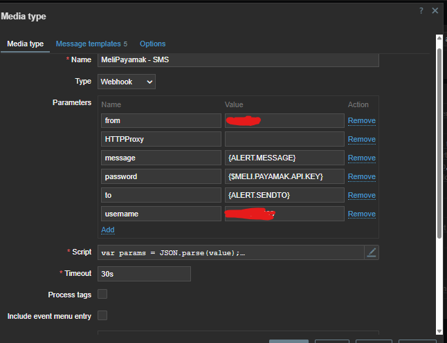

# script
```js
var params = JSON.parse(value);
var request = new HttpRequest();

if (typeof params.HTTPProxy === 'string' && params.HTTPProxy.trim() !== '') {
    request.setProxy(params.HTTPProxy);
}

request.addHeader('Content-Type: application/x-www-form-urlencoded');

function encodeForm(data) {
    var parts = [];
    var key;

    for (key in data) {
        if (data.hasOwnProperty(key)) {
            parts.push(
                encodeURIComponent(key) + '=' +
                encodeURIComponent(String(data[key]))
            );
        }
    }

    return parts.join('&');
}

if (!params.username) {
    throw 'Melipayamak: username is empty';
}

if (!params.password) {
    throw 'Melipayamak: password/API key is empty';
}

if (!params.from) {
    throw 'Melipayamak: sender number is empty';
}

if (!params.to) {
    throw 'Melipayamak: destination number is empty';
}

if (!params.message) {
    throw 'Melipayamak: message is empty';
}

var url = 'https://api.payamak-panel.com/post/sendsms.ashx';

var body = encodeForm({
    username: params.username,
    password: params.password,
    from: params.from,
    to: params.to,
    text: params.message
});

Zabbix.log(
    4,
    '[Melipayamak] URL=' + url
);

Zabbix.log(
    4,
    '[Melipayamak] Sending SMS: from=' +
    params.from +
    ', to=' +
    params.to
);

var response;

try {
    response = request.post(url, body);
}
catch (e) {
    throw 'Melipayamak HTTP request failed: ' + e;
}

var httpStatus = request.getStatus();

Zabbix.log(
    4,
    '[Melipayamak] HTTP status=' +
    httpStatus +
    ', raw response=[' +
    response +
    ']'
);

if (httpStatus < 200 || httpStatus >= 300) {
    throw 'Melipayamak HTTP error: ' +
        httpStatus +
        ', response=' +
        response;
}

/*
 * sendsms.ashx may return either:
 *
 * 12345
 *
 * or:
 *
 * <string xmlns="http://tempuri.org/">12345</string>
 */

var result = String(response).trim();

var xmlMatch = result.match(
    /<string[^>]*>\s*(-?\d+)\s*<\/string>/i
);

if (xmlMatch) {
    result = xmlMatch[1];
}

/*
 * If response is plain numeric text, use it directly.
 */
var numberMatch = result.match(/^-?\d+$/);


var errors = {
    '0': 'Invalid username or password/API key',
    '2': 'Insufficient SMS credit',
    '3': 'Daily sending limit reached',
    '4': 'Sending volume limit reached',
    '5': 'Invalid sender number',
    '6': 'Melipayamak service is under maintenance',
    '7': 'Message contains filtered content',
    '9': 'Sending via this sender/API is not allowed',
    '10': 'User account is inactive',
    '11': 'SMS was not sent',
    '12': 'Account documents are incomplete',
    '14': 'Message contains a link',
    '15': 'Sending restriction / cancellation text required',
    '16': 'Recipient number not found',
    '17': 'Message text is empty',
    '18': 'Invalid recipient number',
    '35': 'Recipient is in telecom blacklist',
    '-108': 'IP blocked due to failed API attempts',
    '-109': 'API source IP must be whitelisted',
    '-110': 'API Key must be used instead of password'
};

if (errors[result]) {
    throw 'Melipayamak API error [' +
        result +
        ']: ' +
        errors[result];
}

var recId = parseInt(result, 10);


return JSON.stringify({
    status: 'sent',
    result: result,
    to: params.to
});


```




